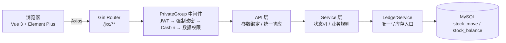

<div align="center">

<h1>JXC 进销存</h1>

<p><strong>基于 Gin-Vue-Admin 二次开发的单店进销存系统</strong><br/>
库存不是一个数字，而是一串不可变的事实。</p>

<p>
  
  
  
  
  
  
  
  
  
</p>

</div>

> 这是一个以**学习全栈开发与领域建模**为主要目的的进销存项目。后端 Go + Gin + GORM，前端 Vue 3 + Vite + Element Plus；登录、RBAC、Casbin、菜单、代码生成等基础设施来自 [Gin-Vue-Admin](https://github.com/flipped-aurora/gin-vue-admin)（v3.0.0），采购、销售、退货、红冲、盘点、库存账本、对账、月报与月结等业务为二次开发实现。
>
> **当前状态**：演示可用、持续完善中。尚未做生产级安全加固，部署到公网前请先阅读 [34-后端工作计划](docs/34-后端工作计划.md)。

## 1. 项目简介

### 1.1 它解决什么问题

面向单店（可扩展多仓）的服装零售场景：

- 商品按 **颜色 × 尺码** 拆成 SKU，库存与成本都挂在 SKU 维度；
- 采购入库、销售出库、客户退货、采购退货、红冲、盘点、期初建账；
- 库存台账、逐笔流水、一键对账、月报与月结；期初建账通过盘点录入，不提供“直接改库存”的入口；
- 每一笔库存变化都能追溯到来源单据与操作人。

核心立场只有一句：**库存的真相是账本，余额只是账本算出来的视图。** 这也是整个项目最值得读的部分，详见 [16-库存账本核心设计](docs/16-库存账本核心设计.md)。

### 1.2 为什么把它当学习项目

| 想练的东西 | 项目里的落点 |
|---|---|
| Go 分层与工程化 | `Router -> API -> Service -> Model`，`enter.go` 组合入口 |
| 数据库事务与并发 | 单事务过账、`SELECT ... FOR UPDATE` 行锁、唯一键幂等 |
| 领域建模 | 账本 / 余额 / 预留 / 期间，成本冻结在账本行上 |
| 权限系统 | JWT + Casbin 路径级授权，5 档角色 219 条策略 |
| Vue 3 工程化 | `<script setup>`、Pinia、Vue Router、Axios 封装、Vite 8 |
| 设计与取舍 | `docs/` 里有完整的设计稿、审计记录与 ADR，包括“为什么不做 FIFO” |

### 1.3 与 Gin-Vue-Admin 的关系

| 能力 | 来源 | 说明 |
|---|---|---|
| 登录、JWT、用户、角色、菜单、API 管理 | Gin-Vue-Admin | 继续复用 |
| Casbin 权限、操作日志、文件上传、代码生成、插件 | Gin-Vue-Admin | 继续复用 |
| 采购、销售、退货、红冲、盘点、账本、报表 | 本仓库 | 二次开发实现 |
| 账本核心 | 本仓库 | **故意不走代码生成器**，见 [ADR-0007](docs/adr/0007-库存改为账本模型.md) |

GVA 提供的是“外壳”，JXC 是长在壳里的业务系统：

- JXC 页面使用**独立工作台壳** `/jxc`，不进入 GVA 的后台菜单表；接口仍然逐条经过 JWT + Casbin；
- 账本要求“只追加、不可改、可重算”，与代码生成器“一表一 CRUD”的世界观不兼容，所以手工实现。

### 1.4 适用场景与边界

**适合**：学习全栈开发、课程设计、个人作品集、单店演示、二次开发起点。

**不适合**：SaaS 多租户、多实例高可用、复杂审批流、批次/序列号追踪、跨境电商等。当前版本是单实例 + MySQL 的务实方案。

## 2. 功能一览

| 模块 | 能力 | 实现要点 |
|---|---|---|
| 工作台 | 库存金额、今日销售额/毛利、待办、低库存、最近流水 | 一个聚合接口，避免首屏多次分页查询 |
| 开单 | 搜索/扫码选货、可售量、键盘操作、原子开单出库 | `/jxc/sale/checkout` 单事务完成建单 + 预留 + 出库 |
| 补货 | 采购单草稿 → 审核 → 入库 | **审核不动库存**，入库才产生账本行 |
| 单据 | 销售/采购/退货/红冲四类，服务端筛选、分页、详情 | 统一 `DocumentSearch` 过滤 |
| 库存 | 台账、逐笔流水、一键对账、盘点、期初建账 | 余额可重算；盘点差异进账本 |
| 报表 | 月报四数（净销售额/净成本/毛利/期末库存）、月结、快照 | 红冲计入发生月；已结账期间冻结 |
| 基础资料 | 仓库、商品、SKU、供应商/客户 | 停用代替删除，保护历史引用 |
| 系统管理 | 用户、角色、菜单、API、日志、字典等 | GVA 原生能力 |

### 2.1 单据状态机

| 单据 | 状态流转 | 过账时机 |
|---|---|---|
| 采购单 | 草稿 → 已审核 → 已入库；可取消 | 入库 |
| 销售单 | 草稿（已预留）→ 已出库；可取消 | 出库 |
| 销售退货 | 草稿 → 已入库；可取消 | 入库 |
| 采购退货 | 草稿 → 已退货出库；可取消 | 过账 |
| 盘点单 | 盘点中 → 已完成；可取消 | 完成 |
| 红冲单 | 即时生效，无草稿态 | 创建即过账 |

> 采购单“审核”只是业务确认，不是库存动作；销售单“开单”会占用预留，但真正减少库存发生在“出库”。

### 2.2 角色与权限

| 角色 ID | 角色 | 能做什么 | JXC 策略数 |
|---|---|---|---|
| 888 | 超级管理员 | 全部 + GVA 系统管理 | 55 |
| 9001 | 老板 | 全部 JXC 业务 | 55 |
| 9002 | 店长 | 除红冲、月结外的全部 | 53 |
| 9003 | 店员 | 开单、退货、盘点录入、查询 | 25 |
| 8881 | 只读 | 查询、工作台、对账结果 | 22 |

权限矩阵落在 [docs/sql/jxc-casbin.sql](docs/sql/jxc-casbin.sql)，可重复执行（先删后插），执行后必须重启后端。

## 3. 核心设计：库存账本

### 3.1 从“一个数字”到“一串事实”

很多进销存的库存实现是“`stock.quantity` + 一张描述性日志”：

| 维度 | 计数器模型 | 账本模型（本项目） |
|---|---|---|
| 库存真相 | 一个可被覆盖的数字 | 只追加的 `stock_move` |
| 余额 | 手工更新 | 由账本聚合出的物化视图 |
| 成本 | 商品表上的“最新进价” | 冻结在每条账本行上的 `unit_cost` |
| 历史毛利 | 会被后来的进价改写 | 不会被改写 |
| 出错处理 | 直接改数 | 红冲，留反向证据 |
| 能否自证 | 不能 | 三条不变量可随时校验 |

账本模型带来的直接结果：**余额可以被重算，历史可以被追溯，错误只能被冲销而不能被抹掉。**

### 3.2 三层模型

| 层 | 作用 | 本项目 |
|---|---|---|
| 单据 | 发生了什么业务 | `purchase_order` / `sale_order` / 退货单 / 盘点单 / 红冲单 |
| 账本 | 对库存与成本的影响，不可变 | `stock_move`（只 INSERT） |
| 余额 | 当前结存，可重算 | `stock_balance`（物化视图） |

### 3.3 数据模型

业务相关共 21 张表（`server/initialize/gorm_biz.go` 的 AutoMigrate 注册）。核心是账本五表 + 发号表：

| 表 | 作用 | 可变性 |
|---|---|---|
| `stock_move` | 账本行：有符号数量、冻结单价、来源单据、幂等键 | 只 INSERT |
| `stock_balance` | 结存数量与金额，`(warehouse_id, sku_id)` 主键 | 只由过账写入 |
| `stock_reservation` | 预留：有归属、可释放、可转出库 | 状态流转 |
| `accounting_period` | 会计期间，`period_month` 唯一 | 打开 → 已结账 |
| `stock_balance_snapshot` | 结账时冻结的余额快照 | 一次写入 |
| `doc_sequence` | 单据号发号器 | 递增 |

业务表：`purchase_order` / `purchase_item`、`purchase_return` / `purchase_return_item`、`sale_order` / `sale_item`、`sale_return` / `sale_return_item`、`stock_reversal`、`stock_check` / `stock_check_item`；主数据：`warehouse`、`goods`、`goods_sku`、`jxc_partner`。

### 3.4 过账规则

| 业务事件 | 账本动作 | 成本取值 |
|---|---|---|
| 采购入库 | `purchase_in`，`qty = +N` | 采购单价 |
| 销售出库 | `sale_out`，`qty = -N` | 出库时按移动加权平均结转 |
| 销售退货入库 | `sale_return`，`qty = +N` | 原销售单该行冻结的成本 |
| 采购退货出库 | `purchase_return`，`qty = -N` | 原采购单价 |
| 盘盈 | `check_gain`，`qty = +diff` | 录入的成本单价（未填则用建单时均价） |
| 盘亏 | `check_loss`，`qty = -diff` | 出库时按当前移动加权平均结转 |
| 红冲 | `reversal`，反向数量 | 复制原账本行 |

> 换货在设计中讨论过，但当前版本没有实现；现有范围是采购、销售、退货、红冲、盘点。

### 3.5 三条不变量

系统把“账对不对”变成可执行的断言：

```text
balance.qty   == SUM(stock_move.qty)
balance.value == SUM(stock_move.amount)
balance.qty - SUM(active reservation.qty) >= 0
```

- 前两条保证余额是账本的忠实投影；
- 第三条保证“可售量”不为负，卖超必须被发现；
- 对账接口会返回 `qty_mismatch`、`value_mismatch`、`negative_available`、`orphan_balance` 等具体违规项；
- 前端顶栏常驻对账状态，点“一键对账”即可校验；结果缓存 60 秒。

对应代码：[server/internal/ledger/invariant.go](server/internal/ledger/invariant.go)；接口：`GET /jxc/ledger/reconcile` 与 `GET /jxc/ledger/reconcile/last`。

### 3.6 红冲与退货不是一回事

| 维度 | 红冲 | 退货 |
|---|---|---|
| 语义 | 单据录错，整单撤销 | 客户/供应商真的退了货，可部分 |
| 数量 | 整单 | 可少于原单 |
| 成本 | 复制原账本行的单价/金额 | 销售退货按原单冻结成本；采购退货按原采购价 |
| 关联 | 一张原单最多一张红冲 | 可多张 |
| 约束 | 已有退货单（含草稿）的销售单不能整单红冲 | 可退数量 = 原单 - 已退 |
| 报表 | 计入红冲发生月 | 计入退货发生月 |

把它们合成“负销售单”是很多进销存的通病：报表里分不清“卖得少”和“录错了”，毛利被两种完全不同的原因同时扭曲。本项目用两张表、两种来源类型分开处理。

### 3.7 成本如何冻结

- **入库**：单价由单据带入，写入 `stock_move.unit_cost` 与 `amount`；
- **出库**：按当前移动加权平均计算成本，四舍五入到“分”，同样落在账本行上；
- **清空库存**：直接把剩余 `value` 全部结转，避免“0 件但账上还剩 0.01 元”；
- **退货**：不按今天的均价，而是按原单冻结的成本/原采购价回补；
- **分位残差**：原单 3 件 100.00，单价只能是 33.33；分三次退时，最后一次用 `AmountOverride` 精确回补 33.34，保证金额回到 100.00；
- **金额运算**：对外仍是“元 + 2 位小数”，对内统一转成“分”的整数，避免 `float64` 累加误差（见 [server/internal/money/money.go](server/internal/money/money.go)）。

### 3.8 并发、幂等与发号

- **幂等键**：`stock_move(source_type, source_id, source_line_id)` 唯一索引。POS 双击、网络重试、消息重投，只要来源相同就只会产生一行；
- **行锁**：过账时对 `stock_balance` 对应行 `SELECT ... FOR UPDATE`，避免丢失更新；
- **单事务**：一张单据的所有明细在同一个事务里过账，要么全成，要么全不成；
- **发号器**：`doc_sequence` 用一行一条“前缀-日期”的记录 + 行锁发号，不依赖 `SELECT MAX(no)+1`，避免并发撞号与间隙锁死锁；
- **盘点并发**：完成盘点时校验账面数是否仍等于建单快照，变了就拒绝并要求重新盘点；
- **原子开单**：建单、预留、出库在一个事务内完成，失败不会残留草稿或预留。

### 3.9 期间与结账

- 过账前校验 `occurred_at` 所属期间必须是“打开”的；
- 已结账期间不能补录，更正只能在当期开红冲单；
- 月结前必须先通过对账，结账时冻结余额快照；
- 红冲计入**红冲发生的月份**，不回头改原单所在月份的报表；
- 当前版本只能结账、不能反结账，这是刻意留的边界（见 [docs/34](docs/34-后端工作计划.md)）。

> 小坑记录：会计期间列名用 `period_month` 而不是 `year_month`，因为 `YEAR_MONTH` 是 MySQL 保留字，裸写进 SQL 会直接语法错误。

### 3.10 设计取舍

- **v1 用移动加权平均，不做 FIFO**：目标场景关心“这个月赚了多少”，不是“这批货赚了多少”；账本模型把成本方法隔离在过账逻辑内部，将来换 FIFO 不需要动单据与报表；
- **禁止跨期回填**：用约束消灭“历史成本被改写”的一整类问题，也避免引入 repost 机制；
- **不做硬删除**：主数据只停用，历史单据与账本仍然引用它们；
- **不追求“功能数量”**：先把账做对，再谈打印、导出、会员、促销。

## 4. 技术栈

### 4.1 总览

| 层 | 技术 | 版本 | 在本项目中的用途 |
|---|---|---|---|
| 后端语言 | Go | 1.24 | API、服务、领域逻辑 |
| Web 框架 | Gin | 1.10 | 路由、中间件、参数绑定 |
| ORM | GORM | 1.31 | 模型、事务、行锁、迁移 |
| 数据库 | MySQL | 8 / 9 | 业务库；InnoDB |
| 权限 | Casbin | v3.10 | 路径 + 方法的 RBAC |
| 认证 | JWT | v5.2 | 登录态 |
| 配置 | Viper | 1.19 | `config.yaml` |
| 日志 | Zap | 1.27 | 结构化日志 |
| 前端框架 | Vue | 3.5 | Composition API |
| 构建 | Vite | 8 | 开发服务器与打包 |
| UI | Element Plus | 2.13 | 业务表格、表单、弹窗 |
| 原子 CSS | UnoCSS | 66.x | 布局、间距、主题 token |
| 状态 | Pinia | 2.2 | 用户、路由、主题 |
| 路由 | Vue Router | 4.4 | 常量路由 + 动态路由 |
| HTTP | Axios | 1.8 | 统一请求封装 |
| 基础组件 | reka-ui | 2.10 | 框架/配置壳层组件库 |
| 图标 | Iconify (lucide) | - | `<svg-icon>` |
| 图表 | ECharts | 5.5 | GVA 自带能力；JXC 报表当前未强依赖 |

> Redis、MongoDB、多云 OSS 等是 GVA 自带能力；当前 JXC 的默认部署**不使用 Redis**，账务一致性依赖 MySQL 事务与行锁。等出现多实例/多门店并发时再评估。

### 4.2 后端：技术栈怎么用

**Gin：分层 + 组合入口**

JXC 全部路由挂在 `PrivateGroup`，中间件链固定为 JWT 鉴权 → 强制改密 → Casbin → 数据权限：

```go
PrivateGroup.Use(middleware.JWTAuth()).
    Use(middleware.MustChangePwdGuard()).
    Use(middleware.CasbinHandler()).
    Use(middleware.DataScope())
```

各层的职责很窄：Router 只注册路由；API 只做参数绑定、校验与统一响应；Service 负责业务规则与事务边界；Model 只管持久化。`enter.go` 继续作为分组注册与组合入口。

**GORM：事务、行锁与迁移**

过账时先锁定余额行，再计算成本、写账本、更新余额：

```go
err := tx.Clauses(clause.Locking{Strength: "UPDATE"}).
    Where("warehouse_id = ? AND sku_id = ?", warehouseID, skuID).
    First(&b).Error
```

几个约定：

- 列表分页统一走 `request.PageInfo`，Service 取 limit/offset 用 `info.LimitOffset()`，内置 `MaxPageSize = 100` 截断；
- 账本相关表的字段变更只允许“加列”，不允许改语义；
- 复合索引不能靠字段 tag 表达时，在 AutoMigrate 后幂等补齐（`ensurePerfIndexes`）。

**Casbin：路径级授权**

策略是“角色 + 路径（keyMatch2）+ 方法”，`:id` 占位可以匹配具体 ID。新库没有策略时连 admin 都会被拒绝，所以启动后必须执行 [docs/sql/jxc-casbin.sql](docs/sql/jxc-casbin.sql)。

**Viper + Zap：配置与日志**

`config.yaml` 由 Viper 读取，Zap 负责结构化日志；请求日志、SQL 日志、panic 恢复分别有独立模块。生产环境务必替换 JWT `signing-key`、数据库密码等默认值。

**纯函数领域包：把最需要验证的数学隔离出来**

`server/internal/ledger` 不依赖 GORM/Gin，只做成本结转与不变量校验；`server/internal/money` 只做“分”的整数运算。这样可以用普通单元测试反复验证最关键的账务逻辑，而不是靠起一整套服务去撞。

**测试：真实 MySQL，而不是 sqlite**

`server/service/jxc` 的集成测试会为每个用例建临时库并在结束时删除；行锁、唯一索引、`ON DUPLICATE KEY` 在 sqlite 上不可信，所以 CI 起了 MySQL 8.4 service。需要 gva 全局单例的测试统一复用 `server/internal/testutil`，不要在各 `_test.go` 里重复手写 sqlite 样板。

### 4.3 前端：技术栈怎么用

**Vue 3.5：`<script setup>` + `defineModel`**

JXC 页面全部使用组合式 API；组件双向绑定统一用 `defineModel()`，不再写 `props.modelValue` + `emit('update:modelValue')` 那套老样板。有限枚举 prop 补 `validator`，纯交互控件补 `aria-label`。

**Vue Router：常量路由与动态路由并存**

`/jxc` 是 `web/src/router/index.js` 里的常量路由，带自己的壳与左导航，不走 GVA 菜单表；其它后台页面仍然使用 GVA 的动态路由。JXC 角色登录后由路由守卫直接落到 `/jxc/workspace`，admin 保留“返回管理后台”。

**Pinia：用户、角色与主题**

`useUserStore` 管理 token、用户信息与角色；`useRouterStore` 管理动态路由与 keep-alive；主题设置单独存放。JXC 壳层只读取 store，不直接碰 localStorage。

**Axios：统一请求封装**

所有接口走 `web/src/utils/request.js`，返回统一结构 `{ code, data, msg }`：

```js
import service from '@/utils/request'

export const checkoutSale = (data) =>
  service({ url: '/jxc/sale/checkout', method: 'post', data })
```

业务页面只判断 `code === 0`，错误提示与 token 失效由拦截器统一处理。

**UnoCSS：原子类 + 语义 token**

JXC 页面优先用 UnoCSS 原子类表达布局、间距、排版与颜色，主题相关颜色走 CSS 变量而不是硬编码色值：

```html
<div class="flex h-screen overflow-hidden bg-main text-base-text">
  <aside class="flex w-[212px] shrink-0 flex-col bg-[var(--jxc-rail-bg)]">
    ...
  </aside>
</div>
```

`bg-main`、`text-base-text`、`border-border`、`text-muted-foreground` 等 token 由 GVA 主题层（`web/src/theme/` 与 `web/uno.config.js`）提供；`web/src/view/jxc/theme.css` 只收敛 JXC 壳层内的 Element Plus 密度与侧栏变量。暗色主题与换肤因此不需要改页面。

**Element Plus 与 reka-ui 的分工**

- 业务页面（表格、表单、弹窗、日期选择）以 Element Plus 为主，开发效率优先；
- 项目的基础组件库以 reka-ui 为底座（`web/src/core/componentLibrary`，全局 `g-` 前缀），用于框架/配置壳层，保证换肤、暗色与主题 token 一致；
- 图标统一用 `<svg-icon>`，在线图标传 Iconify 名（优先 `lucide`），本地图标放 `web/src/assets/icons/*.svg`，不要用 `el-icon` 或手写裸 `<svg>`。

**键盘体验**

| 快捷键 | 作用 |
|---|---|
| `/` | 聚焦开单搜索 |
| `Ctrl/⌘ + Enter` | 开单出库 |
| `Esc` | 清空当前开单 |
| `Ctrl/⌘ + K` | 打开全局命令面板 |
| `Alt + 1..7` | 切换左侧导航 |

### 4.4 技术选型背后的取舍

- 单实例 + MySQL 行锁，而不是上 Redis 分布式锁：先把账做对，再谈扩展；
- 金额用整数“分”，而不是到处 `float64`：避免 0.1 + 0.2 的经典问题；
- 领域数学做成纯函数，而不是塞进 Service：可测、可 review；
- 账本不走代码生成器：生成器适合 CRUD，不适合“不可变事实”；
- 前端独立壳，而不是把 7 个导航入口塞进 GVA 菜单：业务动线更短，也避免菜单表成为业务路由的唯一来源。

## 5. 架构与目录

### 5.1 请求链路



### 5.2 目录结构

```text
JXC/
├── server/
│   ├── api/v1/jxc/          # HTTP handler
│   ├── service/jxc/         # 业务服务；ledger.go 是唯一写库存入口
│   ├── model/jxc/           # 领域模型 + 账本表
│   ├── router/jxc/          # 路由注册
│   ├── internal/
│   │   ├── ledger/          # 成本与不变量（纯函数）
│   │   └── money/           # 以「分」为单位的金额运算
│   ├── initialize/          # gorm / router / 配置初始化
│   └── middleware/          # JWT / Casbin / DataScope 等
├── web/
│   ├── src/api/jxc/         # 接口封装
│   ├── src/view/jxc/        # 独立工作台壳与业务页面
│   ├── src/components/jxc/  # 业务组件
│   └── src/core/            # GVA 外壳与基础组件库
├── docs/                    # 设计、运行、操作、对接与审计
├── scripts/                 # seed / e2e / 演示库重建
├── deploy/                  # Docker / K8s
└── aiDoc/                   # AI 协作上下文
```

### 5.3 分层约定

- Router：只注册路由与中间件；
- API：参数绑定、校验、调用 Service、统一响应；
- Service：业务规则、状态机、事务边界；
- Model：持久化模型、请求/响应模型；
- `enter.go`：分组注册与组合入口；
- Service 不依赖 `gin.Context`，HTTP 相关逻辑留在 API 层；
- 所有 JXC 路由挂在 `PrivateGroup`，中间件顺序为 `JWTAuth -> MustChangePwdGuard -> CasbinHandler -> DataScope`；
- 统一响应 `{ code, data, msg }`，统一分页 `{ list, total, page, pageSize }`。

### 5.4 一次销售出库经历了什么

1. 前端在开单页选择 SKU，调用 `POST /jxc/sale/checkout`；
2. API 层绑定参数、取当前操作人，交给 `SaleService`；
3. `SaleService` 开启事务，创建销售单与明细，逐行写入预留；
4. `SaleService` 把预留转为“已消耗”，组装负向 `MoveInput`，调用 `LedgerService.Post`；
5. `LedgerService.Post` 校验来源与方向、确认期间打开、锁定余额行、计算成本、写入 `stock_move`、更新 `stock_balance`；
6. 回填明细成本、推进单据状态，提交事务；任一步失败整体回滚；成功后返回单号、销售额与成本（前端据此显示毛利）。

这条链路把“状态机”“库存”“成本”“权限”“审计”串在了一起，是读代码的最佳入口。

## 6. 快速开始

### 6.1 环境要求

| 依赖 | 版本 |
|---|---|
| Go | 1.24+ |
| Node.js | 20.19+（CI 使用 20.19.0） |
| MySQL | 8 / 9 |
| Python | 3（仅演示脚本需要，标准库即可） |
| IDE | GoLand / VS Code 均可 |

### 6.2 启动后端并初始化数据库

1. 克隆仓库：

```bash
git clone https://github.com/My-TuDo/JXC.git
cd JXC
```

2. 配置 `server/config.yaml`，首次启动把 `mysql.db-name` 留空：

```yaml
mysql:
  path: 127.0.0.1
  port: "3306"
  username: root
  password: "你的密码"
  db-name: ""
```

3. 启动后端（默认 8888）：

```bash
cd server
go run .
```

4. 初始化数据库（`db-name` 为空时 `/init/checkdb` 才会返回 `needInit: true`）：

```bash
curl -X POST http://127.0.0.1:8888/init/checkdb

curl -X POST http://127.0.0.1:8888/init/initdb -H 'Content-Type: application/json' -d '{"adminPassword":"Admin@123456","dbType":"mysql","host":"127.0.0.1","port":"3306","userName":"root","password":"你的密码","dbName":"erp_v3"}'
```

初始化会建库、建表、写入管理员，并把 `db-name` 回写到 `config.yaml`。**重启后端**切换到新库。

> 为什么必须先留空：`/init/checkdb` 的判定是“能不能连上库”，不是“库里有没有数据”。指向一个已存在的空库时它会说“无需初始化”，结果是表齐了但没有账号。

### 6.3 灌入接口权限（必做）

GVA 的鉴权是“角色 + 路径 + 方法”逐条授权；新库没有策略时，连 admin 都会被拒绝。

```bash
mysql -u root -p erp_v3 < docs/sql/jxc-casbin.sql
```

> 如果初始化时用了别的库名，请把 `erp_v3` 换成实际库名。

灌完**必须重启后端**（Casbin enforcer 有进程内缓存）。

矩阵包含 210 条 JXC 策略 + 9 条基础登录策略 = 219 条，五档角色见 2.2。

### 6.4 启动前端

```bash
cd web
npm ci
npm run dev
```

打开 `http://127.0.0.1:8080/#/jxc`。JXC 角色登录后会直接落到 `/jxc/workspace`；admin 在左侧栏保留“返回管理后台”。

### 6.5 演示数据与冒烟（可选）

```bash
# 在干净库上生成演示数据（会创建演示账号；密码通过参数传入）
python scripts/seed-demo.py --password Admin@123456 --demo-password '<演示密码>'

# 端到端冒烟：采购 → 销售 → 退货 → 红冲 → 盘点 → 对账 → 月报
python scripts/e2e-smoke.py --password Admin@123456
```

注意事项：

- `seed-demo.py` 假设后端已启动、目标库没有业务单据，已有销售单会直接退出；
- 传入 `--demo-password`（至少 8 位）时会创建 `demo_boss`（9001）、`demo_manager`（9002）、`demo_clerk`（9003）、`demo_viewer`（8881）四个账号；
- `e2e-smoke.py` 每次使用独立仓库/SKU，但系统没有删除接口，演示库会累积 smoke 数据，**不要在最终演示库上跑**；
- 登录模式需要临时关闭验证码，或用 `--token` 复用已登录的 `x-token`（详见 [18-运行与演示](docs/18-运行与演示.md)）。

### 6.6 测试

```bash
cd server

# 账本/单据集成测试：需要本机 MySQL；没有可用库时会 Skip
go test ./service/jxc ./internal/ledger -count=1

# 全量
go test ./... -count=1
```

测试默认连 `root:123456@127.0.0.1:3306`；CI 通过 `JXC_IT_MYSQL_BASE` 指定。`server/service/jxc` 会为每个用例建临时库并在结束时删除，不会污染业务库。

前端检查：

```bash
cd web
npm run lint
npm run build
```

### 6.7 常见问题

| 现象 | 原因 | 处理 |
|---|---|---|
| 所有 `/jxc` 接口返回“权限不足” | 策略没灌，或灌了没重启 | 执行 6.3 的 SQL 并重启后端 |
| 登录提示“验证码错误” | 新库 `captcha_open = 0` 表示**始终**要验证码 | 正常输入；或临时改 500 |
| 接口 500 且响应体为空 | handler panic（GVA recovery 吞掉了栈） | 看后端日志 |
| 页面能开但列表全空 | `config` 指向了旧库（表同名但语义不同） | 确认 `db-name` 是新库 |
| 采购单入库后库存没变 | 只点了“审核”没点“入库” | 到“单据 → 采购单”点“入库” |
| 结账提示“账实不符” | 余额被直接改过 | 先到“库存 → 对账”看差额 |
| 红冲提示“已卖出不能红冲” | 这批货已经卖掉一部分，整单冲回会变负库存 | 用退货处理，或先处理客户退货单 |

## 7. 文档地图

| 文档 | 内容 | 什么时候看 |
|---|---|---|
| [docs/18-运行与演示](docs/18-运行与演示.md) | 冷启动、权限矩阵、演示数据、冒烟、十分钟验收 | 第一次跑起来 |
| [docs/19-操作手册](docs/19-操作手册.md) | 店主视角的操作说明与常见问题 | 想知道“点哪里” |
| [docs/16-库存账本核心设计](docs/16-库存账本核心设计.md) | 为什么库存必须是账本；表结构、过账规则、不变量、成本方法 | 读代码之前 |
| [docs/20-对接文档](docs/20-对接文档.md) | 技术栈、目录、数据模型、接口契约、业务规则 | 接手改代码 |
| [docs/21-接手审计](docs/21-接手审计.md) | 实际验证到的缺陷、已修项、剩余风险、文档与代码不一致清单 | 动手前先看 |
| [docs/33-上线演示环境与验收](docs/33-上线演示环境与验收.md) | 演示库、账号、seed、重建步骤、验收清单与回滚 | 准备演示/上线 |
| [docs/34-后端工作计划](docs/34-后端工作计划.md) | 演示后/生产化 roadmap：安全整改、反结账、聚合计数、多实例触发条件 | 上线前 |
| [docs/README.md](docs/README.md) | 全部文档索引 | 找文档 |
| [AGENT.MD](AGENT.MD) | 项目级 AI 协作规则 | 用 AI 改代码 |
| [aiDoc/README.md](aiDoc/README.md) | 结构化 AI 上下文：模块规则、前后端契约、示例与记忆 | 用 AI 改代码 |

推荐阅读顺序：

- **第一次接触**：18 → 19 → 16 → 20；
- **要改代码**：20 → 21 → 16 → ADR-0007；
- **要上线**：34 → 33 → 18；
- **用 AI 协作**：AGENT.MD → aiDoc/README.md。

## 8. 已知限制与后续计划

### 8.1 当前不包含

- 小程序、扫码枪投递、手机查库存；
- 多仓调拨、批次/序列号追踪；
- 单据打印与导出、批量导入；
- 会员、储值、促销折扣；
- 主数据硬删除（只提供停用）；
- 反结账（只能结账，错了走红冲）。

### 8.2 生产化前必须做（P0）

- `server/config.yaml` 脱跟踪，补 `config.yaml.example`，全历史扫描并轮换真实密钥；
- 反向代理封禁 `/init/*`，关闭公开注册，验证码保持开启；
- 依赖与 CI 门禁：`npm ci`、`go test`、secret scanning、分支保护。

### 8.3 后续优先级（P1/P2）

| 优先级 | 事项 |
|---|---|
| P1 | 反结账（需产品决策）、单据/Tab 聚合计数、JXC Swagger 补齐、审计与可观测性 |
| P2 | 多实例 + Redis（有明确触发条件再做）、模糊搜索优化、低库存阈值配置化、历史归档/分区 |

完整的优先级、工作量与验收标准见 [34-后端工作计划](docs/34-后端工作计划.md)。

## 9. 从 README 到代码：推荐阅读路线

如果你想通过这个项目学习，建议按下面顺序读，而不是从 `main.go` 开始逐行看：

1. [server/model/jxc/ledger.go](server/model/jxc/ledger.go)：先看注释，理解为什么库存必须是账本；
2. [server/internal/ledger/cost.go](server/internal/ledger/cost.go)：移动加权平均、清空库存、按原价冲回、按精确金额回补；
3. [server/internal/ledger/invariant.go](server/internal/ledger/invariant.go)：三条不变量如何被写成纯函数；
4. [server/service/jxc/ledger.go](server/service/jxc/ledger.go)：`Post` / `Reserve` / `Reconcile`，看事务、行锁、幂等键；
5. [server/service/jxc/sale_service.go](server/service/jxc/sale_service.go)：销售状态机与原子开单；
6. [web/src/view/jxc/sale/index.vue](web/src/view/jxc/sale/index.vue) 与 [web/src/api/jxc/index.js](web/src/api/jxc/index.js)：前端如何把一次开单串起来；
7. [docs/16-库存账本核心设计.md](docs/16-库存账本核心设计.md)：最后回到设计稿，看取舍与代价。

读的时候可以带着这几个问题：

- 为什么 `unit_cost` 要落在账本行上，而不是商品表上？
- 为什么退货必须用原单成本，不能用今天的均价？
- 为什么最后一条退货需要 `AmountOverride`？
- 同一来源重复过账时，系统靠什么保证只产生一行？
- 为什么已结账期间不能再写入？代价是什么？
- 如果不用账本，这套业务会在哪些地方出错？

## 10. 参与开发

- 当前开发分支：`rewrite/jxc-v3`，功能分支请从它切出；
- 提交信息建议使用语义化格式：`type(scope): description`，例如 `feat(jxc): 增加采购退货查询筛选`；
- 改动账务逻辑必须补测试，至少覆盖：正常过账、重复过账、库存不足、期间已结账、红冲/退货边界；
- 涉及金额与库存的改动，先跑 `go test ./service/jxc ./internal/ledger -count=1`；
- 前后端契约变化时，同步更新 `docs/` 与 `aiDoc/frontend-backend/`；
- 不要提交 `server/config.yaml` 中的真实密码、`.local/` 下的 token、演示账号密码或任何密钥；
- AI 辅助开发请先阅读 [AGENT.MD](AGENT.MD)，项目级规则以它为准。

## 11. 许可证与致谢

### 11.1 许可证

本仓库沿用上游 **Business Source License 1.1（BSL 1.1）**，详见 [LICENSE](LICENSE)。

- 个人使用、评估/开发、教育用途在 Additional Use Grant 允许范围内可免费使用；
- 商用、生产部署、对外提供服务或移除版权/署名信息，需要获得商业授权；
- 请保留仓库、日志与界面中的版权声明。

> 本项目主要面向学习与演示，不构成任何生产可用性或财务合规承诺。

### 11.2 上游项目

- [Gin-Vue-Admin](https://github.com/flipped-aurora/gin-vue-admin)：提供登录、RBAC、Casbin、菜单、代码生成、插件与后台管理基础设施；
- 上游原始中文 README 已归档到 [docs/upstream/README.md](docs/upstream/README.md)，版权归原作者所有；
- 上游英文 README：[docs/upstream/README-en.md](docs/upstream/README-en.md)；
- 上游许可证与商用授权说明以 [LICENSE](LICENSE) 与 [Gin-Vue-Admin 官方文档](https://www.gin-vue-admin.com/) 为准。

### 11.3 参考

- [Gin](https://gin-gonic.com/)、[GORM](https://gorm.io/)、[Casbin](https://casbin.org/)、[Vue 3](https://vuejs.org/)、[Vite](https://vite.dev/)、[Element Plus](https://element-plus.org/)、[UnoCSS](https://unocss.dev/)
- 账本模型与不变量检查的成熟实现参考：ERPNext `Stock Ledger Entry` / `Stock Ledger Invariant Check`、Odoo `stock.valuation.layer`（详见 [docs/16](docs/16-库存账本核心设计.md) 的参考一节）。
